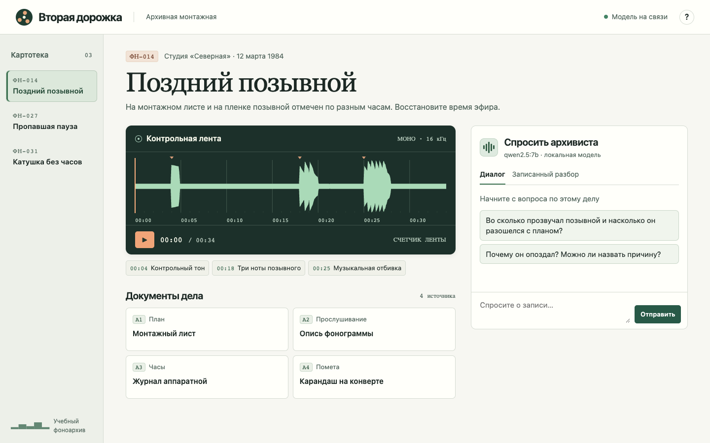

# Вторая дорожка

Лабораторная работа № 3 «Мой агент». Диалоговый помощник архивиста, который сверяет радиозапись с документами эфира. [Задание кафедры](https://github.com/MAILabs-Education/MyAgent)

## Замысел · Project Statement

На конверте с пленкой кто-то карандашом написал «смена пластинки?». Позывной действительно опоздал на четыре секунды. Достаточно ли этого, чтобы связать два события? С такого вопроса начинается «Вторая дорожка». Здесь можно услышать позывной, найти запись дежурного и задать архивисту второй вопрос о причине опоздания. Для времени у него есть расчет по двум часам, для причины — только неподписанная помета.

Мы собрали три учебных дела. В первом удается восстановить точное время, во втором — измерить пропуск, в третьем приходится оставить вопрос открытым. Больше всего мы хотели, чтобы ответ можно было проверить самому. Нажмите на источник, чтобы прочитать запись дежурного, или прослушайте два фрагмента, в которых архивист нашел один позывной. Отдельный опыт с переговорами Apollo 11 дает сделать то же на историческом материале. Можно услышать сообщение о посадке, открыть его в стенограмме и прочитать, что ответил Хьюстон.

## Демонстрация

[Посмотреть трехминутную демонстрацию со звуком](images/demo.mp4) · [Скачать русские субтитры](images/demo.vtt)

В первую минуту слышны контрольный тон и три ноты позывного. Архивист отвечает на вопрос вживую, а ссылка под ответом открывает журнал аппаратной. С 01:29 показан сохраненный разбор двух ударов. В 02:12 начинается поиск позывного по волне, с 02:27 — сверка двух записей Apollo 11. В 02:45 можно прочитать ответ Хьюстона на странице 317, а в 02:53 открывается восстановленная страница 491 с полным сканом.



Скриншоты разборов можно открыть в полном размере. [Время позывного](images/02-airtime.png) · [Сравнение двух ударов](images/03-gap.png) · [Катушка без часов](images/04-unknown.png) · [Поиск позывного по звуку](images/05-sound-search.png)

## Как запустить

Понадобятся Python 3.11–3.14 и Poetry 2. Установку, запуск и тесты проверили в четырех чистых окружениях на macOS с Apple Silicon, по одному на каждую версию Python. [Результаты установки](examples/evaluation/installation.json)

Из корня репозитория выполните

```bash
poetry install
poetry run python -m studio
```

Откройте монтажную в браузере. Без запущенной модели откроется «Записанный разбор» с шестью сохраненными ответами на три дела. Перейдите в «Диалог», чтобы проверить на своей катушке позицию звука или найти реплику NASA по точному времени. [Монтажная](http://127.0.0.1:8765)

Для свободных вопросов о содержании документов запустите локальную Ollama. Если она уже работает, достаточно загрузить модель. В отдельном терминале выполните

```bash
ollama serve
```

Еще в одном терминале загрузите модель. После загрузки обновите страницу и выберите «Диалог».

```bash
ollama pull qwen2.5:7b
```

Для другой конфигурации перед запуском приложения задайте `ARCHIVE_MODEL` (имя модели в Ollama), `OLLAMA_HOST` (адрес Ollama) или `ARCHIVE_PORT` (порт монтажной). Чтобы повторить опыт с компактной Gemma, выполните `ollama pull gemma3:1b`, затем запустите монтажную командой `ARCHIVE_MODEL=gemma3:1b poetry run python -m studio`. [Gemma 3 1B в Ollama](https://ollama.com/library/gemma3:1b)

## Что получилось

| Дело | Что спросили | Что удалось установить |
| --- | --- | --- |
| ФН-014 «Поздний позывной» | Когда он прозвучал и почему опоздал? | Тон на 00:04 соответствует 21:17:10 в журнале. Позывной вступает на 00:18, значит, в эфире было 21:17:24. По сетке он опоздал на 4 секунды. На конверте «смена пластинки?» записана как догадка. Причину опоздания установить не удалось. [Диалог и вызовы инструментов](examples/signal.json) |
| ФН-027 «Пропавшая пауза» | Сколько секунд не хватает и что исчезло? | В эфире между ударами прошло 25 секунд, на копии — 20. Оригинал и лист склеек в архив не поступили. Разницу в 5 секунд можно измерить, место и содержание пропуска остаются неизвестными. [Диалог и вызовы инструментов](examples/splice.json) |
| ФН-031 «Катушка без часов» | Можно ли восстановить время заставки? | Заставка начинается на 00:12. В сетке указано 09:40:00, графа фактического выхода пуста. Для пересчета нужен источник, где хотя бы одно событие на этой пленке отмечено по эфирным часам. [Диалог и вызовы инструментов](examples/untimed.json) |

## Что попробовать в монтажной

В первом деле спросите «На какой секунде копии начинается музыкальная отбивка?». Под ответом можно открыть опись и сразу услышать музыку с 00:25. [Проверка позиции и воспроизведения](examples/evaluation/positions/browser.json)

**Один позывной на двух катушках.** В первом деле нажмите «Три ноты позывного», раскройте «Найти похожий звук» и запустите поиск по архиву. На ФН-014 позывной вступает на 00:18, а на ФН-031 те же ноты нашлись на 00:12. Нажмите «Сверить эфирные часы». Для первой катушки журнал дает 21:17:24, для второй сохранились только счетчик копии и план выпуска. Из этой же карточки можно прослушать оба фрагмента и открыть журнал любой из катушек. В диалоге тот же разбор начинается с вопроса «Найди по звуку, где еще в архиве встречаются эти три ноты». [Сверка в интерфейсе](images/08-repeat-clocks.png) · [Журнал живого диалога](examples/evaluation/reels/qwen25-repeats.json)

**Две оцифровки Apollo 11.** В «Сверке записей NASA» начните с 2,50 с. На расширенной записи спектр указывает на 3,41 с, и этот фрагмент можно сразу послушать. Для другой передачи порог не пройден. Чтобы услышать влияние скорости воспроизведения, выберите учебную копию. Программа находит тот же звук на 3,0282 с и измеряет изменение скорости +1,70 %. Восстановление времени миссии по счетчику отдельного аудиофайла требует дополнительной опоры. [Интерфейс](images/06-public-audio.png) · [Источники и контрольные суммы](data/field/SOURCES.md)

**Проверка цитаты на бумаге.** Введите `the Eagle has landed` в поиске по стенограмме. Строка Армстронга и ответ Хьюстона разделены двумя секундами на странице 317. В диалоге можно спросить «Кто это сказал?» или «Что ответили затем?». В корпусе 624 страницы и 8 452 размеченные реплики. В исходном OCR на странице 491 была только помета о поврежденном файле. Мы восстановили 17 строк по полному скану. Попробуйте также ввести `two cups of coffee` и выбрать страницу 578, чтобы сверить рассказ о завтраке. Для поиска по русскому описанию вместе с Qwen можно загрузить `ollama pull embeddinggemma:300m`. [Страница в монтажной](images/07-transcript.png) · [Полный скан листа 491](data/field/nasa-page-491.pdf)

## Результаты проверок

Метки можно ввести через запятую, чтобы увидеть только начала реплик в эти секунды, или через тире, чтобы прочитать весь интервал. Поиск по времени миссии помогает проверить даже саму стенограмму. Введите `059:26:41`. Эту метку мы нашли на страницах 182 и 253. На второй вокруг нее напечатаны отметки 83-го часа. В монтажной можно открыть скан, увидеть разницу в дне и прочитать каждую строку в контексте. [Снимок поиска](images/09-mission-clock.png) · [Скан страницы 253](data/field/nasa-page-253.pdf)

| Что проверили | Что получилось |
| --- | --- |
| Учебные дела на Qwen2.5 7B | 6/6 исходных вопросов, 9/9 проверок диалога и звука, 6/6 дополнительных формулировок. [Сохраненные прогоны](examples/evaluation/scoped) |
| Переход от найденного звука к эфирным часам | Сначала архивист отвечал временем исходной катушки. После проверки обоих дел серия на Qwen выросла с 4/9 до 9/9. Gemma 3 1B тоже прошла 9/9. [До](examples/evaluation/reels/before.json) · [Qwen](examples/evaluation/reels/qwen25-repeats.json) · [Gemma](examples/evaluation/reels/gemma3-1b-repeats.json) |
| Русский вопрос к английскому архиву | На семи исходных пересказах Qwen2.5 выросла с 3/7 до 7/7. На шести других вопросах Qwen2.5 и Qwen3-30B прошли по 5/6, причем ошибки различались. Первая пропустила шутку о соревновании, вторая приняла приглашение за сообщение о победе. [Qwen2.5](examples/evaluation/scoped/qwen25-holdout.json) · [Qwen3-30B](examples/evaluation/scoped/qwen3-30b-holdout.json) |
| Поиск копии с измененной скоростью | На 12 искусственно измененных фрагментах обычное сравнение волн дало 0/12. С поправкой удалось найти 12/12. На четырех сравнениях с другой передачей ложных совпадений не было. [Измерения](examples/evaluation/speed-scan.json) |

Подробный журнал содержит сравнение моделей, условия каждого опыта, ссылки на исходные записи и случаи, в которых архивист ошибся. [Открыть журнал экспериментов](examples/evaluation/README.md)

## Как устроен агент

- **Диалог и ReAct.** Для каждой катушки ведется своя история. LangGraph передает модели вопрос, недавние реплики и результаты вызовов. Модель выбирает следующее действие в формате JSON и после каждого наблюдения решает, достаточно ли материала для ответа. В интерфейсе можно раскрыть «Ход проверки» и увидеть то, что вернул инструмент. [Граф и системный промпт](studio/agent.py)
- **Поиск по источникам.** В трех учебных делах 12 коротких документов на русском. Поиск BM25 работает в пределах открытого дела, приводит русские слова к общей основе и учитывает предметные синонимы. Для ответа о причине модель выбирает предложения из найденных документов. В стенограмме NASA время миссии, обозначение говорящего и номер страницы хранятся у каждой размеченной реплики. Инструменты `search_transcript` и `read_transcript` дают архивисту искать и читать соседние строки. [Поиск по делам](studio/archive.py) · [Индекс стенограммы](studio/transcript.py)
- **Инструменты MCP.** Отдельный процесс получает вызовы по стандартному вводу и выводу. Инструмент `locate_marker` связывает счетчик катушки с эфирными часами. Для интервала на самой пленке `tape_span` вычитает показания двух меток. Для вопроса о расхождении с эфиром `compare_span` сопоставляет показания по двум источникам. Значения в ответе берутся из измерения вместе с номерами документов. [MCP-сервер](studio/mcp_server.py) · [Расчеты](studio/clock_tools.py)
- **Поиск по образцу.** Инструмент `match_sound` читает отсчеты WAV. Для него мы взяли готовую корреляцию из SciPy, вычли среднее из каждого окна и учли его громкость. Окна, пересекающиеся с самим образцом, исключаются. Результат содержит позицию для прослушивания и коэффициент сходства. Метод рассчитан на копии фрагмента с одинаковой скоростью. По одному сходству нельзя установить, когда запись вышла в эфир и откуда взялась катушка. [Реализация](studio/audio_search.py) · [Корреляция в SciPy](https://docs.scipy.org/doc/scipy/reference/generated/scipy.signal.correlate.html)
- **Методические памятки.** Одна помогает переносить время с контрольного тона на другое событие. Вторая разбирает, что доказывает разница интервалов. Третья объясняет выбор образца и смысл найденного сходства. Агент может открывать их в ходе диалога. [Сверка часов](skills/check_clock.md) · [Проверка длительности](skills/check_gap.md) · [Поиск по звуку](skills/match_sound.md)
- **Монтажная.** Волна строится по амплитудам WAV-файла. Кнопка с названием метки переносит плеер на соответствующую секунду. Записи синтезированы для задания, события в них размечены заранее. При подключении настоящего архива понадобится отдельно подготовить опись и связать ее с документами. [Интерфейс](studio/web/index.html) · [Генератор фонограмм](tools/make_tapes.py)

## Как повторить проверку

В первой команде модель не используется. Для двух следующих запустите монтажную и Ollama. Живой прогон сохраняет вопрос, ответ, использованные инструменты и ссылки на источники.

```bash
poetry run python -m pytest -q
poetry run python tools/evaluate.py --suite repeats --label local --out /tmp/archive-repeats.json
poetry run python tools/evaluate.py --suite scoped --label local --out /tmp/archive-pages.json
```

Все остальные серии, пересборка индекса и отдельный опыт с классификаторами описаны в журнале. [Команды воспроизведения](examples/evaluation/README.md#как-повторить-проверку)

## Использование ИИ · AI Use Statement

Codex подготовил план по условиям лабораторной, спроектировал три дела, написал код, тесты, интерфейс и черновик отчета. До живых прогонов мы зафиксировали ожидаемые результаты по каждому комплекту документов. После прогонов сверили ответы с этими результатами, открыли источники и проверили переход плеера к меткам. Исходная постановка и шесть вопросов для воспроизведения сохранены в репозитории. [Замысел и вопросы](IDEA.md)

Для приложения выбрали локальную Qwen2.5 7B. На учебных делах также испытали Gemma 3 1B, Phi-4-mini 3.8B и Qwen3-VL 8B. На исторической стенограмме сравнили Qwen2.5 и Gemma с Qwen3-30B-A3B. Для поиска по смыслу использовали локальную EmbeddingGemma 300M. Способность моделей DeBERTa проверять утверждения по одной цитате испытали на 20 размеченных парах. Модель выбирает инструменты и выдержки из документов, а для английской стенограммы подбирает слова для поиска. Время и длительность рассчитывает Python. Видео снято в работающем интерфейсе, комментарий озвучен системным голосом Milena. Тон, музыка и удары взяты из учебных WAV. Голоса в эпизоде Apollo 11 звучат с опубликованных записей NASA. [Промпт и выбор действия](studio/agent.py) · [Работа с цитатами](studio/transcript_agent.py) · [Источники записей](data/field/SOURCES.md)

## Участники и роли

Для защиты предлагаем распределить участки между участниками команды следующим образом.

| Участник | Участок работы |
| --- | --- |
| Харунжин Максим | Методика сверки эфирных часов, расчеты MCP и проверка случаев с недостающими опорами. |
| Сухарев Александр | Граф диалога, подключение локальной модели, сборка Python-приложения и воспроизведение прогонов. |
| Лемещенко Мария | Тексты архивных дел, поиск по документам и проверка того, какие утверждения подтверждает каждый источник. |
| Цапко Нелли | Браузерная монтажная, воспроизведение меток, сценарий демонстрации и сверка звука с изображением. |

## Выводы

Первый вариант архивиста правильно вычислил пять пропавших секунд, а затем уверенно указал, где они исчезли. Мы открыли акт приемки и увидели, что основания для этого нет. После этого изменили само формирование ответа. Число приходит из измерительного инструмента, а пояснение о причинах модель собирает из предложений, которые действительно прочитала. В повторном диалоге она указала на акт приемки и оставила место пропуска открытым.

Работа с катушкой без часов выявила другую ошибку. Агент изучил несколько звуков подряд и в ответе показал время последнего из них вместо заставки, о которой его спросили. Теперь название события в вопросе сверяется с меткой измерения. Именно поэтому в контрольных прогонах мы проверяем сразу три вещи — полученное число, соответствующий ему звук и документ, который позволяет сделать вывод.
